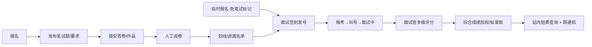

# 网络信息协会招新系统（YUNA_PAF_SYS）项目计划

> 定稿日期：2026-10-11

## 1. 概述

覆盖社团招新全流程：报名、笔试题发布、答卷/作品提交、人工评分、面试签到、临时报名、面试叫号、面试评分、录取结果通知与查询。

**已确认决策：**

| 决策项 | 结论 |
|---|---|
| 交付形态 | H5 Web（考生扫码使用，无应用商店审核） |
| 笔试形式 | 纯主观题/作品提交；不做在线限时考试、不做客观题自动判分 |
| 通知渠道 | 仅站内结果查询 + 协会群引导；不接短信 |
| 技术栈 | FastAPI + SQLAlchemy + PostgreSQL + Redis；Vue3（管理端 Element Plus / 考生端 Vant） |

**工作量：基线 ≈33.5 人天；复用开源与表单引擎 ≈29，含看板 ≈30.5，含一致性加固 ≈31.5 人天（推导见第 10–12 节）**
**日历：3 人团队（2 开发 + 1 产品/测试，课余投入）≈ 8–9 周**

## 2. 角色与端

| 角色 | 使用端 | 核心操作 |
|---|---|---|
| 考生 | H5（手机） | 报名、提交答卷/作品、查结果 |
| 管理员 | Web 后台 | 批次/题目/名单/划线/录取发布 |
| 阅卷员 | Web 后台 | 主观题匿名评分 |
| 签到员 | Web/平板 | 签到发号、临时报名补录、过号处理 |
| 面试官 | Web/平板 | 叫号、多维评分、备注 |

## 3. 核心流程

## 4. 模块拆解与工作量（最终版）

| # | 模块 | 内容 | 人天 |
|---|---|---|---|
| 1 | 基础设施 | 脚手架、认证（考生验证码/密码 + 后台账号）、RBAC 五角色、Docker 部署 | 4.5 |
| 2 | 报名 + 临时报名 | 报名表单（志愿/学号查重）、名单筛选导出 Excel、现场快速补录 + 免笔试标记 | 4 |
| 3 | 笔试发布与收集 | 题目/要求发布（可视化模板、时间窗口）、考生提交（文本+附件、截止前可改）、人工阅卷（单人评分+评语）、成绩汇总、考后解析公布（题目+参考答案，发布开关，发布前考生不可见） | 7.5 |
| 4 | 面试签到叫号 | 扫码签到发号、队列状态机（候考/叫号/面试中/完成/过号/缺考）、SSE 实时大屏、多面试组并行分流 | 4.5 |
| 5 | 面试评分 | 面试官可见考生全部信息（不盲面）；星级（0.5~5、半星）必选 + 分数（总分批次自定义）选填 + 评价必填；多人取均分 | 2.5 |
| 6 | 录取与查询 | 全程不筛人：综合分 = 笔试×w₁ + 面试×w₂（权重与名额 N 可配）排名取前 N；本人查询页 + 管理员发布开关 | 2.5 |
| 7 | 后台公共件 | 批次管理、进度看板、操作日志 | 3 |
| 8 | 测试与演练 | 全链路测试、内部模拟一场完整招新彩排、面试现场并行叫号演练 | 3.5 |
| 9 | 文档 | 部署手册、管理员操作手册、交接文档 | 1.5 |
| | | **合计** | **33.5** |

## 5. 核心数据模型

- `RecruitmentBatch` 招新批次（唯一进行中的批次控制各阶段开关）
- `Applicant` / `Application`（学号 per 批次唯一；部门/方向志愿；免笔试标记）
- `ExamPaper` 题目/要求（富文本+附件、发布/截止时间窗口）
- `Submission` 答卷（文本 + 附件，状态：草稿/已提交；截止前可改）
- `Grade` 阅卷记录（阅卷人、分数、评语；多人阅卷取均分）
- `InterviewGroup` 面试组（按部门/方向分流）
- `QueueEntry` 队列（号码、状态：待签到/候考/面试中/完成/过号/缺考）
- `InterviewScore` 面试评分（各维度分、备注、盲面开关生效）
- `AdmissionResult`（录取状态、发布时间）

## 6. 关键设计点

- 交卷截止以**服务器时间**为准；窗口内可反复修改，截止后锁定。
- 叫号推送用 SSE（单向）+ 轮询兜底；大屏本地缓存最近状态，签到员可手动改号（弱网兜底）。
- 临时报名者打“免笔试”标记，按纯面试分参与排名。
- 附件上传：类型白名单 + 大小上限（建议 ≤20MB）。
- 个人信息（手机号/学号）权限最小化，导出留操作日志。
- 防作弊只做软限制（发布窗口、附件留痕），对外不承诺硬防。

## 7. 风险与对策

| 风险 | 对策 |
|---|---|
| 面试现场弱网 | 大屏缓存 + 人工改号兜底；现场最容易乱的单点，演练必须覆盖 |
| 多面试组并行叫号 | 原型阶段按"组"建队列 |
| 临时报名无笔试成绩 | 免笔试标记 + 综合分规则提前定稿 |
| 结果发布瞬间查询高峰 | 量级千级，静态化查询页/缓存即可 |
| 交接断档 | 管理员手册 + 部署文档 + 演练录屏 |

## 8. 里程碑（3 人团队 / 10 周）

- W1：原型 + 表结构定稿
- W2–3：基础设施 + 报名 → 可演示报名
- W4–5：笔试发布/提交/阅卷 → 内部模拟收集与评分
- W6–7：面试签到/叫号/评分 → 模拟现场（含并行叫号）
- W8：录取 + 查询页 + 后台看板
- W9：全链路彩排 + 修复
- W10：上线 + 现场保障 + 文档交接

## 9. 部署与成本

- 单机 Docker Compose：app + PostgreSQL + Redis + Nginx（HTTPS，Let's Encrypt）。
- 2C4G 轻量云 + 域名 ≈ ¥60–100/月；无短信费用。
- 数据库每日 cron 备份，招新结束后归档留档。

## 10. 开源参考与复用（2026-10-11 调研结论）

垂直领域（招新全流程：报名+笔试+评分+面试叫号+录取）**没有成熟的完整开源系统**。策略：脚手架直接复用 + 领域项目只抄设计。

### 直接复用（省人天）

| 项目 | 许可证 | 复用什么 |
|---|---|---|
| [fastapi/full-stack-fastapi-template](https://github.com/fastapi/full-stack-fastapi-template) | MIT | 后端骨架：JWT 认证、SQLModel/Alembic 迁移、Docker Compose、Traefik 自动 HTTPS、Pytest/CI。前端为 React，弃用换成 Vue3 |
| [vben-admin](https://github.com/vbenjs/vue-vben-admin) / [vue-element-plus-admin](https://github.com/kailong321200875/vue-element-plus-admin) | MIT | 管理端布局、RBAC 菜单权限、表格/表单 CRUD 模板 |
| Vant | MIT | 考生 H5 端组件库 |

### 仅参考（抄交互与数据模型，不引代码）

| 项目 | 许可证 | 参考点 |
|---|---|---|
| [学之思 uexam](https://github.com/alvis-u/uexam)（原版） | MIT | 试卷/题目/阅卷/成绩的完整数据模型与阅卷交互；Spring Boot 2.1 老栈，勿 fork |
| [TDuck tduck-survey-form](https://github.com/TDuckCloud/tduck-survey-form) | MIT | 报名表单：防重复提交、逻辑跳题、Excel 导出、附件打包下载；Java 平台不做集成 |
| [LedoKun/028-simple-queue-system](https://github.com/LedoKun/028-simple-queue-system) | MIT | 叫号大屏全套：SSE 推送、operator/signage 双端、TTS 语音播报、断线兜底——与第 6 节设计一致，可照抄交互 |
| [LexaTang/interviewer](https://github.com/LexaTang/interviewer) | MIT | 面试排队+评分的模块拆分（Queue 与 Room 分离）；Scala+Vert.x，仅看设计 |

### 明确不做

- 整体 fork 学之思：技术栈 Java+老版本 Vue，且功能（题库/客观题判分/小程序）远超本项目裁剪后范围，改造成本高于自研。
- 把 TDuck 嵌入单体：异构平台（SpringBoot+Vue2），报名表单自研仅 1.5 人天，集成反而贵。

### 估算影响

复用 fastapi 模板 + 管理端脚手架后：模块 1 由 4.5 → 2.5 人天，模块 7 约省 1 人天。**总量 33.5 → 约 30 人天**。

### 表单引擎集成（2026-10-11 补充）

选型：[form-create](https://github.com/xaboy/form-create)（MIT，7.1k★，Vue3）+ [form-create-designer](https://github.com/xaboy/form-create-designer)（MIT，2.4k★）。

**选型理由：** 同一 JSON rule 双端渲染——`@form-create/designer@next`（Element Plus）供管理员在后台拖拽设计表单，`@form-create/vant`（Vant 移动端）在考生 H5 渲染同一 schema。与既定技术栈零偏差，是唯一同时官方支持 Element Plus 与 Vant 的主流方案。

**集成架构：**

1. 新增 `FormTemplate` 表（`schema` 存 jsonb）：报名表单、笔试答卷模板均为一条模板记录，按批次绑定。
2. 管理端嵌入 `<fc-designer>`：管理员拖拽出题/出报名表 → 保存 rule JSON。
3. 考生 H5 用 `@form-create/vant` 渲染 rule → 提交数据存 `submission.data`（jsonb，按字段 ID 键控）。
4. 业务关键字段（学号、手机号、部门志愿）保持固定列 + 数据库唯一约束；其余问题进 jsonb。前端校验仅做体验，后端对关键字段重新校验。
5. 附件上传组件指向自有上传接口（类型白名单 + 大小上限）。

**引擎化边界：** 报名表单与笔试答卷模板走引擎（次年改题不改代码）；面试评分表保持手写（固定维度打分，引擎化无收益）。

**落选方案：** SurveyJS（渲染库 MIT 但 Creator 设计器为商业授权，见 [licensing](https://surveyjs.io/licensing)）；[vueform](https://github.com/vueform/vueform)、[vue-form-create](https://github.com/fuchengwei/vue-form-create)（MIT 但社区小、无 Vant 适配）。

**估算影响：** 模块 2/3 各省 1 人天（表单配置化 + 渲染复用），集成与自定义组件成本 +1 人天。**总量 30 → 约 29 人天**。

## 11. 管理后台与数据可见性（2026-10-11 补充）

目标：招新全程"看得见"——每个阶段一张主表 + 一个漏斗，面试现场可投屏。数据全部来自自有业务表，无需外部 BI。

### 后台信息架构（导航）

| 一级菜单 | 内容 |
|---|---|
| 概览 Dashboard | 招新漏斗、关键数字卡、各部门进度总表；`?fullscreen=1` 即投屏"现场模式" |
| 报名管理 | 名单筛选、详情、临时报名补录、Excel 导出 |
| 笔试管理 | 答卷模板（form-create）、提交列表、阅卷进度、划线 |
| 面试现场 | 签到台、叫号控制、各面试组队列总表、评分入口 |
| 录取管理 | 综合分、拟录取、发布、结果统计 |
| 系统设置 | 用户/角色（RBAC）、操作日志 |

### 指标体系

- **招新漏斗**：报名 → 交卷 → 达线进面 → 签到 → 面试完成 → 拟录取 → 确认加入。
- **各部门进度总表（投屏主表）**：部门 | 报名 | 交卷率 | 进面 | 已面 | 待面 | 缺考 | 笔试均分 | 面试均分 | 拟录取 | 录取率。
- **趋势**：报名期每日新增；笔试期阅卷完成率；面试日每小时完成吞吐 + 预计等待时长（待面人数 × 平均面时 ÷ 并行官数）。
- **实时性**：统计页复用叫号 SSE 通道推送刷新，与叫号大屏同源；候场大屏只叫号，指挥台/面试室投屏看统计——两页分开，避免信息过载。

### 可见性原则

- 单一数据源：直查业务表聚合（千级量无需预聚合/数仓），与名单页数字永远一致。
- 权限分级：面试官仅见本组；投屏页脱敏（号码 + 姓，如"张**"）；导出仅管理员且写操作日志。

### 技术落点

- 图表：[ECharts](https://github.com/apache/echarts)（Apache-2.0）+ vue-echarts（MIT）——漏斗图/趋势线/分布饼图全覆盖。
- 表格：Element Plus `el-table`（已在栈内），支持列固定与筛选。
- 导出：后端 openpyxl 流式 Excel。

### 估算影响

模块 7 后台公共件 +1.5 人天（Dashboard 页 1 + 现场投屏模式 0.5）。**总量 29 → ≈30.5 人天**，日历维持 8–9 周（缓冲吸收）。

## 12. 数据一致性加固（2026-10-11 补充）

四条原则：

1. **数据库是唯一事实源**——均分、综合分、看板统计等派生数据一律查询时聚合，不落冗余列，消灭"两处数字不同"这一类问题。
2. **约束尽量下沉数据库**——唯一约束、外键、CHECK、条件更新，不依赖应用层自觉。
3. **写入幂等**——同一操作重复提交产生同一结果。
4. **SSE 只通知不承载数据**——事件只表示"该刷新了"，客户端重拉 DB 状态；断线重连即全量对齐。

### 风险 → 加固清单

| 风险点 | 加固手段 | 落点 |
|---|---|---|
| 重复报名/重复交卷 | `UNIQUE(batch_id, applicant_id)` 双表唯一约束；提交接口幂等（重复请求返回首次结果） | 模块 2/3 |
| 并发叫号（两面试官同时"叫下一个"） | 条件更新：`UPDATE queue_entry SET status='面试中', room_id=? WHERE id=? AND status='候考'`，影响行数=0 说明已被叫走，重新取下一个 | 模块 4 |
| 签到发号重号 | 组内序号单事务原子自增（DB `UPDATE ... RETURNING`），不用 Redis 计数 | 模块 4 |
| 评分重复提交 | `UNIQUE(queue_entry_id, interviewer_id)` + upsert | 模块 5 |
| 评分后推进队列跨步失败 | 评分落库 + 队列状态推进在**同一事务**内 | 模块 4/5 |
| 截止后仍交卷/阶段错位操作 | API 层校验 + 批次状态机（报名/笔试/面试/录取四阶段开关），服务器时间为准 | 模块 1/7 |
| 已发布成绩被改 | 阶段状态机：批次进入"面试/录取"后答卷锁定；录取发布后重算须显式"撤回发布"（记日志） | 模块 3/6 |
| 临时报名晚于划线 | 免笔试者插入面试队列为独立动作，幂等可重放；不影响已划线笔试名单 | 模块 2/4 |
| 孤儿附件（上传成功未提交） | cron 清理 24h 未引用文件 | 模块 3 |
| 看板与名单数字不一致 | 同一聚合查询出口，看板不另算一套 | 模块 7/11 |
| 划线重复执行 | 划线=单事务内按分数线重建进面名单，可重复执行（幂等覆盖） | 模块 3 |
| 误操作/纠纷回溯 | 操作日志（谁在何时改了什么）+ 录取发布前自动 DB 快照 + 导出存档 | 模块 6/7 |

### 验证要求（并入模块 8 彩排）

- 并发用例：同一账号双开同时交卷、两面试官同时叫号、重复点击签到/评分——结果必须与单次执行一致。

### 估算影响

多数手段是各模块的实现规范（不新增模块）；新增并发测试用例 0.5 + 附件清理/发布前快照 0.5。**总量 30.5 → ≈31.5 人天**，日历维持 8–9 周。

## 13. 脚手架落地（2026-10-11）

W1 之外的工程骨架已按第 10 节选型落地于本仓库（`server/` + `admin/` + `h5/` 单仓三端），已验证：

- 后端：pytest 6/6（重复报名、幂等交卷、并发叫号、重复完成、RBAC/阶段越权、解析发布可见性门）；alembic 迁移可升级（含 exam_answers）；uvicorn 实启冒烟通过。
- 前端：admin 与 h5 均可 `npm run build` 通过；管理端含登录、概览（漏斗 + 部门表 + 投屏模式）、报名管理（CSV 导出）、form-create 可视化设计器、笔试解析编辑发布、叫号台（SSE）；考生端含学号注册登录、报名、答卷提交、笔试解析页。

骨架已覆盖模块 1 的大部与模块 2/3/4/5/7 的核心路径样例；阅卷工作台、评分录入、综合分与录取发布、附件上传、用户/日志管理页按里程碑推进。运行方式见根目录 `README.md`。

## 14. 需求基线（2026-10-19 与用户逐条确认）

以下决策覆盖此前章节中的冲突表述（如多人阅卷、盲面、划线淘汰），以本节为准：

1. **筛选逻辑**：全程不筛人。笔试、面试均只评分不淘汰；最终按 **综合分 = 笔试×w₁ + 面试×w₂** 排名，取前 N 录取。权重 w₁/w₂ 与名额 N 由管理员按批次配置。
2. **笔试形式**：在线主观题/作品提交（维持现状）。不引入客观题与自动判分。
3. **阅卷**：单人评分——每位阅卷人对答卷给分 + 评语，不做多人复评/均分。
4. **面试评分**：面试官可见考生全部信息（含笔试成绩与答卷，**不做盲面**）；评分三件套：**星级 0.5~5（半星步进，必选）+ 分数（总分按批次自定义，如 40 分制，选填）+ 评价（必填）**；同一人多面试官时取均分。笔试阅卷沿用同一套三件套规范。
5. **结果发布**：考生登录 H5 查询**本人**录取状态；管理员一键发布后生效。不做公开名单页，不接短信/公众号。
6. **通知**：以"本人查询页 + 协会群公告引导查询"为准，系统不做主动推送。

对已建模的影响：`InterviewScore` 的盲面开关废弃（面试官始终可见）；`Grade/InterviewScore` 保留 upsert 语义；综合分权重与名额需新增批次级配置（实现录取模块时落 `RecruitmentBatch` 列或配置表）。

### 2026-10-19 补充确认

7. **多志愿**：报几个部门就面几个部门——每个部门队列各一条记录；互斥只锁"进行中"：处于已叫号/面试中的人，其他组叫号自动跳过，面完即解除。
8. **自动叫号调度器**：状态变更即触发（完成/签到/过号/缺考同事务内补位），无后台守护；选取规则 = 占用排除 → 签到 FIFO → 过号者按已等待时长加权插队；**完成后面试官缓冲 60 秒（组级可调）再叫下一位**；组级暂停开关；人工操作永远覆盖自动。
9. **表范式**：管理端/现场端一切页面 = "一张主表 + 行内动作"，状态列只能由动作推进、不可手改（对标飞书多维表格并消除其打勾乱象）；考生 H5 与叫号大屏除外。
10. **轻量模式（今年）**：报名与笔试收集留飞书，CSV 导入名单 + 笔试成绩/评级/批注；系统只跑面试现场（签到/叫号/评分）+ 录取。全权模式（明年）再启用系统内报名与在线笔试。模块间唯一耦合点是 CSV 导入器。
11. **笔试题发布改为 Markdown**：题库不再是 form-create 模板，而是一份版本化 Markdown 文档（管理端编辑、考生端渲染）；作答固定字段（文本 + 作品链接 + 附件）。报名表单仍保留可视化设计器。
12. **面试参考批注**：阅卷时可写"仅面试官可见"的批注，面试评分页同屏展示该生笔试分/评级/批注。
13. **签到信息门槛**：发号前强制姓名 + 手机齐全，缺一由签到台当场补录，否则不发号。

## 15. 实施计划（按功能模块细分，2026-10-19）

排序原则：面试现场是今年主战场（去年痛点集中），先行；前半场今年走飞书+CSV 缝合。

### 模块 A · 面试现场核心（最高优先）

| # | 内容 | 验收 | 人天 |
|---|---|---|---|
| A1 | 房间资源模型（组内多房间、占用状态）+ 自动调度器（完成/签到/过号同事务补位，缓冲 60s 组级可调，暂停开关，跨组互斥跳过） | 两房间并发完成不叫重；别组面试中的人被跳过；暂停后不自动叫号 | 2.5 |
| A2 | QueueEntry 时间戳（签到/被叫/完成）+ 平均面时与预计等待（冷启动默认 8 分钟，≥3 个完成后用真实均值），大屏与签到台显示 | 等待时间随真实面时收敛 | 0.5 |
| A3 | 过号 / 重排（按已等待时长加权插队）/ 缺考 | 过号者重排后位置反映等待时长 | 1 |
| A4 | 签到台信息强制补全（姓名+手机不全不发号，当场补录） | 缺手机签到返回 422 并提示补录 | 0.5 |
| A5 | 未面试名单（状态筛选 + 一键 CSV 导出） | 导出与队列页数字一致 | 0.5 |

### 模块 B · 评分规范统一

| # | 内容 | 验收 | 人天 |
|---|---|---|---|
| B1 | `InterviewScore` 改造：星级 0.5 步进必选 + 分数（批次总分校验）选填 + 评价必填；评分页同屏展示笔试分/评级/面试参考批注；`(考生,面试官)` upsert | 缺评价 422；分数超总分 422；重复提交覆盖不新增 | 1.5 |
| B2 | 评分明细表视图（管理端，按组/面试官筛选） | 与数据库行数一致 | 0.5 |

### 模块 C · CSV 导入缝合（今年轻量模式必需）

| # | 内容 | 验收 | 人天 |
|---|---|---|---|
| C1 | 报名名单 CSV 导入（列格式待飞书样例），按学号 upsert，逐行错误报告 | 重复导入不产生重复行 | 1 |
| C2 | `Application` 增列：笔试分、笔试评级、面试参考批注，随导入落库 | 面试评分页可见导入值 | 0.5 |

### 模块 D · 笔试链路收尾（可明年启用）

| # | 内容 | 验收 | 人天 |
|---|---|---|---|
| D1 | 笔试题 Markdown 化：版本化 md 文档（编辑/发布），考生端 markdown-it 渲染；作答固定字段（文本+作品链接+附件） | 管理员改题考生端即时生效 | 1.5 |
| D2 | 附件上传（类型白名单 + ≤20MB + 24h 孤儿清理） | 超限/非法类型 422 | 1 |
| D3 | 阅卷工作台（按部门表视图，星级+分数+评价+面试批注，单人评分） | 部长只见本部门卷子 | 2 |

### 模块 E · 录取

| # | 内容 | 验收 | 人天 |
|---|---|---|---|
| E1 | 批次级权重 w₁/w₂ 与名额 N 配置；综合分排名；拟录取名单生成（幂等可重算） | 重复生成结果一致 | 1 |
| E2 | 发布开关 + 考生 H5 本人查询页（发布前 404） | 与解析公布同一门控模式 | 1 |

### 模块 F · 加固与演练

| # | 内容 | 验收 | 人天 |
|---|---|---|---|
| F1 | 全链路彩排（协会内部模拟完整招新）+ 并发用例压测 | 彩排问题清零 | 1.5 |
| F2 | 部署演练 + 管理员操作手册 | 新机器按手册可独立部署 | 1 |

**合计约 14.5 人天。** 今年轻量模式必需：A + B + C + E（约 8 人天）；D 可推迟到明年全权模式。依赖：B1 依赖 A1；E 依赖 B 与笔试分来源（C2 或 D3）；C1 待飞书导出样例。
