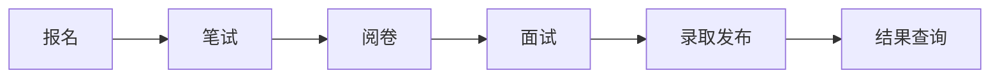

# YUNA_PAF_SYS · 网络信息协会招新系统

协会招新全流程系统：报名、笔试、阅卷、面试现场、录取发布、结果查询，一个系统走完。

去年用飞书多维表格办招新，面试现场很乱：打勾式叫号漏叫错叫、跨部门抢人、重复评分记录、等待时间看不见、现场报名只留个名字叫不到人、评分标准五花八门。这个系统就是为彻底解决这些乱象而做。

## 招新流程（每个阶段谁做什么）

### 1. 报名

- 考生用手机打开报名页：学号、姓名、手机、部门志愿为必填，其余问题管理员可自由配置（每年换题不改代码）
- 面试当天可现场临时报名：工作人员代录，姓名和手机不全不能发号
- 也可以继续用飞书收集，导出 CSV 一键导入系统

### 2. 笔试

- 管理员用 Markdown 发布题目与要求，设定作答时间窗口
- 考生在窗口内在线作答，截止前可反复修改，截止后自动锁定
- 考后管理员发布"笔试解析"页（题目 + 参考答案），发布前考生看不到

### 3. 阅卷

- 部长按部门分卷，每份卷子一人评
- 统一评分规范（见下），阅卷时可写"面试参考批注"，只有面试官能看到

### 4. 面试（重点解决的混乱）

- **签到发号**：签到台搜名字/学号发号，信息不全当场补全
- **候考大屏**：当前号码 + 预计等待时间（按真实面试时长动态估算）
- **自动叫号**：面试结束缓冲 60 秒后自动叫下一位；正在别组面试的人自动跳过；人工随时可以接管、暂停
- **有事离开**：标记"过号"保留资格，回来按已等待时长重排；一直不来标"缺考"
- **面试评分**：面试官同屏看到该生的笔试成绩、评级和批注，用统一规范打分
- **多志愿**：报几个部门就面几个部门，但同一时刻只能在一个组面试中
- **未面试名单**：随时一键导出

### 5. 录取

- 综合分 = 笔试分 × 权重 + 面试分 × 权重，取前 N 名（权重和名额管理员按年配置）
- **全程不淘汰**：笔试面试都只评分，最后算总账
- 管理员一键发布后，考生登录查**自己的**结果；不做公开名单、不发短信

## 评分规范（笔试面试同一套）

| 项 | 规则 |
|---|---|
| 星级 | 0.5 ~ 5 星，可打半星，**必填** |
| 分数 | 选填，总分管理员按批次自定（今年填 40 即 40 分制） |
| 评价 | **必填**，写清打分原因 |

## 功能清单（按模块）

| 模块 | 包含功能 | 状态 |
|---|---|---|
| 报名 | 在线报名、临时报名、名单导出 | 能用 |
| 笔试 | 题目发布、窗口作答、解析公布 | 能用（题目将改为 Markdown 形式） |
| 面试现场 | 签到发号、候考大屏、手动叫号 | 能用 |
| 面试现场 | 自动叫号、等待预估、过号/重排/缺考、未面试导出 | 开发中 |
| 评分 | 面试评分三件套、评分明细、阅卷工作台 | 开发中 |
| 数据缝合 | 飞书 CSV 导入 | 等飞书导出样例 |
| 录取 | 综合分排名、发布开关、本人查询页 | 开发中 |
| 看板 | 招新漏斗、各部门进度总表、投屏模式 | 能用 |

每个功能的验收标准和开发顺序见 [PLAN.md](./PLAN.md) 第 3 节。

## 两种用法

| | 轻量模式（今年） | 全权模式（明年） |
|---|---|---|
| 报名、笔试收集 | 继续用飞书，CSV 导入 | 用本系统 |
| 面试现场、录取 | 用本系统 | 用本系统 |

模块互相独立，资源不够可以只跑面试现场这一块。

## 参与开发

技术栈：FastAPI + Vue3，单仓三端（`server/` 服务端、`admin/` 管理端、`h5/` 考生手机端）。
怎么启动、怎么用演示数据、提交代码的纪律，都在 [PLAN.md](./PLAN.md) 第 4 节。
