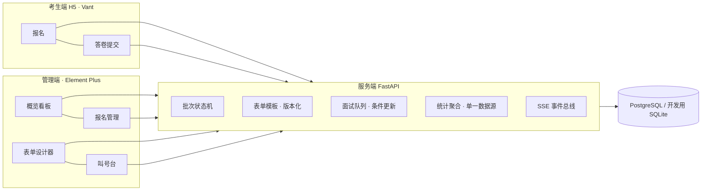

# YUNA_PAF_SYS · 网络信息协会招新系统

面向高校社团招新全流程的一体化系统：**报名 → 笔试题发布 → 答卷提交 → 人工阅卷 → 面试签到/叫号 → 面试评分 → 录取结果通知与查询**，附实时数据看板与投屏模式。

> 项目计划、工作量估算、一致性设计、开源选型结论全部在 **[PLAN.md](./PLAN.md)**（13 节）。

## 功能总览

| 功能 | 状态 | 说明 |
|---|---|---|
| 报名 / 临时报名 | 已落地 | 学号每批次唯一（DB 约束兜底）；现场补录打免笔试标记 |
| 笔试题发布 | 已落地 | form-create 可视化设计，模板版本化，考生端即时生效 |
| 笔试提交 | 已落地 | 窗口期内幂等重复提交（同 ID 覆盖），阶段切换自动锁定 |
| 笔试解析公布 | 已落地 | 考后发布题目与参考答案；发布前考生一律 404，不暴露草稿 |
| 笔试评分（阅卷工作台） | 规划中 | 单人评分 + 评语（需求基线 §14） |
| 面试签到 / 发号 | 已落地 | 组内序号原子自增，重复签到由唯一约束拒绝 |
| 面试叫号 | 已落地 | 条件更新防并发重复叫号；SSE 实时推送大屏 |
| 面试评分 | 规划中 | 面试官可见全部信息，打分 + 打分原因必填；`(考生, 面试官)` 唯一 + upsert |
| 录取结果通知与查询 | 规划中 | 综合分 = 笔试×w₁ + 面试×w₂（权重与名额可配），本人查询页 + 管理员发布开关 |
| 数据看板 | 已落地 | 漏斗 + 各部门进度总表，`?fullscreen=1` 投屏模式 |

## 架构



单仓三端：`server/`（FastAPI + SQLAlchemy 2.0 + Alembic）、`admin/`（Vue3 + Element Plus + fc-designer + ECharts）、`h5/`（Vue3 + Vant + @form-create/vant）。

## 快速开始（开发）

前置：Python ≥3.12 + [uv](https://docs.astral.sh/uv/)、Node ≥20。

```bash
# 1. 后端（端口 8100，首次启动自动建表并播种 admin/admin123456）
cd server && uv sync
uv run uvicorn app.main:app --port 8100 --reload
# API 文档：http://localhost:8100/docs

# 2. 管理后台（端口 5173）
cd admin && npm install && npm run dev

# 3. 考生 H5（端口 5174）
cd h5 && npm install && npm run dev
```

前端开发服务器已配置 `/api` 代理至 `127.0.0.1:8100`。

### 演示数据

```bash
cd server
uv run python scripts/seed_demo.py phase1   # 报名期：批次 + 两张表单 + 6 名报名者
uv run python scripts/seed_demo.py phase2   # 面试日：交卷 ×4 + 签到 ×3 + 叫号 ×1
```

考生演示账号：`20260001 / pass123456`。

### 测试与构建

```bash
cd server && uv run pytest          # 一致性与流程用例（重复报名/幂等交卷/并发叫号/RBAC）
cd admin && npm run build           # 产物 admin/dist
cd h5 && npm run build              # 产物 h5/dist
```

## 生产部署

```bash
cp .env.example .env                # 必改 YUNA_JWT_SECRET（32+ 字节随机串）
docker compose up -d --build        # postgres + redis + server
```

容器入口自动执行 `alembic upgrade head`；生产环境置 `YUNA_AUTO_CREATE_DB=false`，用迁移建表而非自动建表。

## 设计要点（详见 PLAN.md）

- **一致性加固**（第 12 节）：约束下沉数据库、写入幂等、SSE 只做刷新信号、派生数据不落列；`server/app/services/queue_service.py` 是条件更新防并发叫号的参考实现。
- **表单引擎**（第 10 节）：管理端 `fc-designer` 拖拽出题 → schema 存 jsonb → 考生端 `@form-create/vant` 同源渲染；次年改题不改代码。
- **批次状态机**：报名→笔试→面试→录取→归档，仅允许逐级推进；单活批次由部分唯一索引保证。

## 维护备忘（踩坑记录）

- `@form-create/vant` 注册的全局组件名是 **`FormCreateMobile`**（`<form-create-mobile>`），与 PC 端 `<form-create>` 不同名。
- Windows 下 `alembic.ini` 必须保持纯 ASCII（configparser 以 locale 编码读取，中文注释在 GBK 环境直接崩溃）；含中文的 Python 文件没问题。
- Windows 本机跑 Alembic 如遇编码问题，命令前加 `PYTHONUTF8=1`。
- 考生约定：**用户名 = 学号**。

## 目录结构

```
PLAN.md                 计划与设计文档（13 节）
server/
  app/
    api/routes/         auth / batches / applications / submissions / forms / queue / health
    core/               配置、DB、JWT/bcrypt
    models/             全部领域模型与一致性约束
    services/           队列条件更新、SSE 事件总线、审计日志
  alembic/              迁移
  scripts/seed_demo.py  演示数据
  tests/                API 一致性测试
admin/src/
  views/                登录 / 概览 / 报名管理 / 表单设计 / 面试现场
  types.ts              前后端 wire 契约
h5/src/
  views/                登录 / 首页 / 报名 / 笔试答卷
```

## 开发路线

当前：**骨架已落地**（认证/RBAC、批次状态机、报名、笔试发布与提交、面试队列叫号、看板、三端可构建可运行）。下一步按 PLAN.md 第 8 节里程碑：阅卷工作台 → 面试评分 → 综合分与录取发布 → 附件上传 → 用户/日志管理页。
